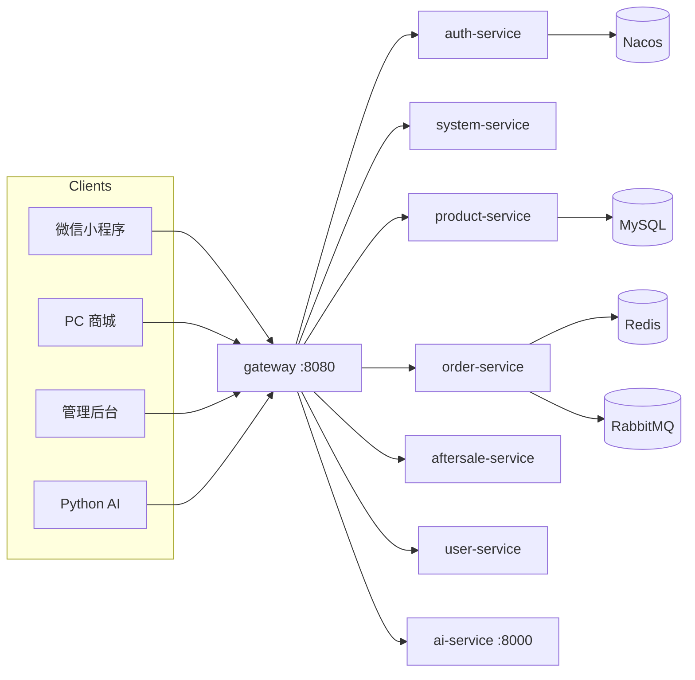
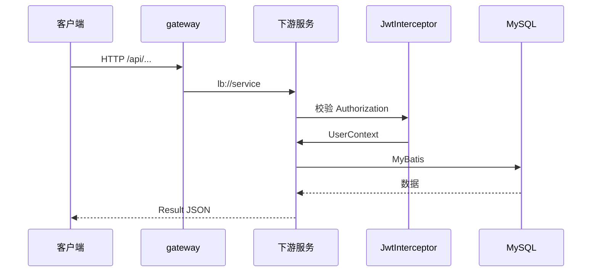

# e-commerce-boot 系统架构

## 概述

e-commerce-boot 是一套面向微信小程序、PC 商城与管理后台的 Java 微服务电商后端。它让 C 端用户完成浏览、收藏、下单、支付、评价与售后，让运营人员完成商品、库存、订单、财务、会员与 RBAC 管理。

系统以 Spring Cloud Gateway（8080）为统一入口，下游服务通过 Nacos 注册，前端不直连 900x 端口。JWT 鉴权与按钮权限由各服务 `JwtInterceptor` / `PermissionInterceptor` 承担，网关只做路由与 Host 保留。

另有 Python `ai-service`（默认 `127.0.0.1:8000`）承接导购/客服机器人；Java 侧通过 `/internal/ai/**` 提供内部数据接口，由 `InternalApiInterceptor` 校验 `X-Internal-Token`。

生产侧通过 `deploy/docker-compose.yml` 编排 Java 服务、Redis、Nacos 与 AI 服务；MySQL 通常在宿主机。本地可用根目录 `docker-compose.yml` 起 Nacos 与可选 MySQL。

## 技术栈

**语言与运行时**
- Java 17
- Spring Boot 4.1.0
- Spring Cloud 2025.1.3
- Spring Cloud Alibaba 2025.1.0.0

**框架**
- Spring Cloud Gateway（WebFlux 路由）
- Spring MVC（各业务服务）
- MyBatis Spring Boot Starter 4.0.1
- springdoc-openapi 3.1.1
- JJWT 0.13.0
- Apache POI 6.0.0（Excel）

**数据存储**
- MySQL 8（库名 `e_commerce_db`）
- Redis（下单幂等、管理员会话/吊销、分类缓存等）
- RabbitMQ（order-service 配置，本地默认 guest）
- 本地磁盘 `upload/`（商品图 `/image/**`、头像 `/upload/**`）

**基础设施**
- Nacos 3.x 服务发现（8848 / gRPC 9848、9849）
- Docker Compose（开发中间件与生产 Java 镜像）
- 宝塔 Nginx 反代网关（见 `deploy/nginx-api.conf`）

**外部服务**
- 微信小程序登录（user-service，`WECHAT_APPID` / `WECHAT_SECRET`）
- Python AI 导购（网关静态 URI，非 Nacos）

## 项目结构

```
e-commerce-boot/
├── pom.xml                 # 父工程：模块与 BOM
├── common/                 # 共享 Result、JWT、拦截器、促销计算、操作日志、任务监控
├── gateway/                # 8080 入口，Nacos lb 路由 + Swagger 聚合
├── auth-service/           # 管理员登录、验证码、当前用户
├── product-service/        # 商品、分类、标签、促销、库存、文章、Banner、收藏
├── order-service/          # 购物车、订单、地址、优惠券、发货、财务、评价、报表、WS
├── aftersale-service/      # 售后申请与后台处理
├── user-service/           # 微信/PC 用户、会员、反馈、头像静态资源
├── file-service/           # 独立文件服务模块（当前几乎仅启动类）
├── system-service/         # RBAC、菜单角色、监控、API 文档同步、库表备份
├── deploy/                 # 生产 Compose、Dockerfile、Nginx 示例
├── docker-compose.yml      # 本地 Nacos + MySQL
└── docs/                   # 运维与专题计划（非本 Wiki）
```

**入口点**
- `gateway/.../GatewayApplication.java` — 网关
- `*/.../*ServiceApplication.java` — 各业务服务
- 路由定义：`gateway/src/main/resources/application.yml`

## 子系统

### Gateway
**目的**: 路径分流、Swagger 聚合、AI 静态转发、WebSocket 转发  
**位置**: `gateway/`  
**关键文件**: `application.yml`, `GatewayApplication.java`  
**依赖**: Nacos、下游服务、`AI_SERVICE_URL`  
**被依赖**: 小程序、管理端、Nginx

### Common
**目的**: 统一响应、JWT、权限注解、内部 API 拦截、促销报价、操作日志、可监控定时任务  
**位置**: `common/src/main/java/ecommerce/`  
**关键文件**: `common/Result.java`, `interceptor/JwtInterceptor.java`, `configuration/WebMvcConfig.java`  
**依赖**: Spring MVC、JJWT、Redis（会话相关）  
**被依赖**: 除 gateway 外的业务模块

### Auth / System
**目的**: 后台登录与系统管理（用户、角色、菜单、日志、监控）  
**位置**: `auth-service/`, `system-service/`  
**依赖**: MySQL、JWT、Redis 在线会话  
**被依赖**: 管理后台

### Product
**目的**: 商品域与库存、内容运营  
**位置**: `product-service/`  
**依赖**: MySQL、上传目录、内部 AI 接口  
**被依赖**: 商城首页、下单读商品（order 有独立 ProductMapper 只读片段）

### Order
**目的**: 交易闭环（车、单、券、物流、财务、评价、报表）  
**位置**: `order-service/`  
**依赖**: MySQL、Redis、RabbitMQ、WebSocket `/ws/**`  
**被依赖**: 小程序交易、后台订单与财务

### Aftersale
**目的**: 售后单与状态流转  
**位置**: `aftersale-service/`  
**依赖**: MySQL、订单只读 Mapper  
**被依赖**: C 端售后页、后台售后、AI 内部查询

### User
**目的**: C 端账号、会员、反馈；`/api/**` 未匹配路径的兜底服务  
**位置**: `user-service/`  
**依赖**: 微信 API、MySQL、`/upload/**`  
**被依赖**: 小程序登录与个人中心

## 图表




