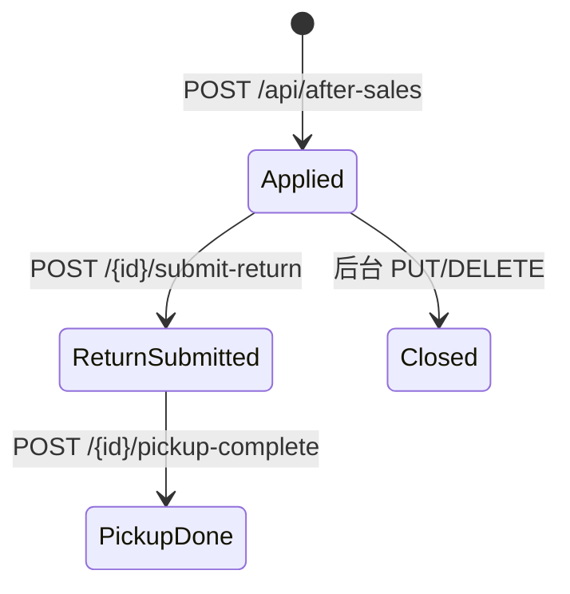

# 售后 AfterSale

售后单记录用户对已购订单的退款/退货/换货申请，并留下操作日志。

## 什么是售后？

售后是独立微服务中的领域对象，不与订单服务共享写模型；aftersale 内有只读 `OrderMapper.xml` 用于校验订单。

**关键特征**:
- C 端 `/api/after-sales`
- 管理端 `/api/admin/after-sales`
- 子表：仅退款、退货、换货退货、明细、日志（对应多份 Mapper XML）

## 代码位置

| 方面 | 位置 |
|------|------|
| C 端 | `AfterSaleController.java` |
| 管理端 | `AdminAfterSaleController.java` |
| 内部 AI | `InternalAiController.java` |
| XML | `aftersale-service/src/main/resources/mappers/aftersale/` |

## 结构

C 端动作：创建、列表、分页、counts、status-constants、by-order、详情、submit-return、pickup-complete、logs。

管理端：列表、详情、logs、PUT 更新、DELETE。

## 不变量

1. 操作需登录（网关注释）。
2. 状态常量由 `GET /status-constants` 下发，前后端不以魔法数硬编码为佳。
3. 内部查询走 `/internal/ai/aftersale/{id}` + 内部 Token。

## 生命周期

细分退款/退货/换货状态机以 Mapper 与 Service 为准，文档不编造未读过的枚举表。

## 关系

| 关联 | 关系 | 描述 |
|------|------|------|
| Order | 属于 | `by-order` 查询 |
| AfterSaleLog | 包含 | 进度日志 |
