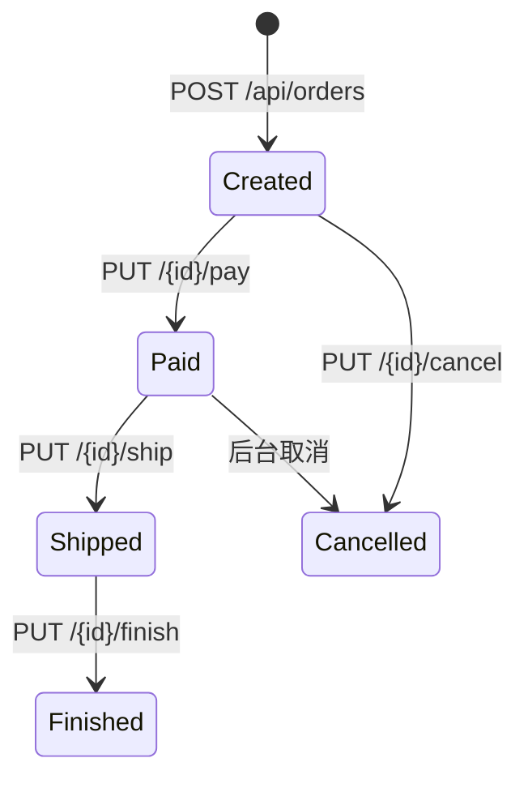
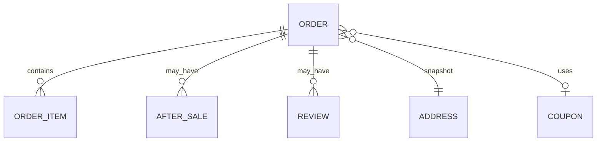

# 订单 Order

订单是交易主实体：用户对购物车/立即购买报价后下单，经历支付、发货、完成或取消，并可评价与售后。

## 什么是订单？

订单代表一次购买合约，含头表、明细、地址快照、优惠与物流信息。

**关键特征**:
- C 端接口在 `order-service` 的 `OrderController`
- 后台发货、取消、删除在 `AdminOrderController`
- 报价 `POST /api/orders/quote` 使用 common 促销计算器
- Redis 用于下单幂等（见 order-service `application.yml` 注释）

## 代码位置

| 方面 | 位置 |
|------|------|
| Controller | `order-service/.../controller/OrderController.java` |
| Admin | `AdminOrderController.java` |
| Mapper XML | `order-service/src/main/resources/mappers/order/OrderMapper.xml` |
| 明细 | `OrderItemMapper.xml` |
| 发货 | `OrderDeliveryMapper.xml` |

## 结构

订单字段以 MyBatis XML 与 VO 为准（`OrderMapper.xml` 体量较大）。常见操作：列表、分页、counts、详情、物流、pay/ship/finish/cancel/delete。

### 关键行为

| 接口 | 描述 |
|------|------|
| quote | 下单前计价 |
| pay | 用户支付 |
| ship | 发货（C 端与管理端均有 ship） |
| finish | 确认收货 |
| cancel | 取消 |
| review | `POST /api/orders/{id}/review` |

## 不变量

1. **需登录**：网关注释写明购物车/订单操作由下游 JWT 拦截器鉴权。
2. **超时关单 / 自动确认**：order-service 配置了定时任务线程池，任务互不阻塞。
3. **精确状态码**：`GET /api/admin/orders/status-constants` 与 C 端 counts 配套；具体枚举值以代码常量为准。

## 生命周期

状态名以接口语义描述；数据库列的数字/字符串枚举请对照 `status-constants` 接口，此处不臆造数值。

## 关系

| 关联 | 关系 | 描述 |
|------|------|------|
| 购物车 | 来源 | `/api/cart` |
| 售后 | 后续 | aftersale-service |
| 财务收据 | 支付侧 | `/api/admin/finance` |
