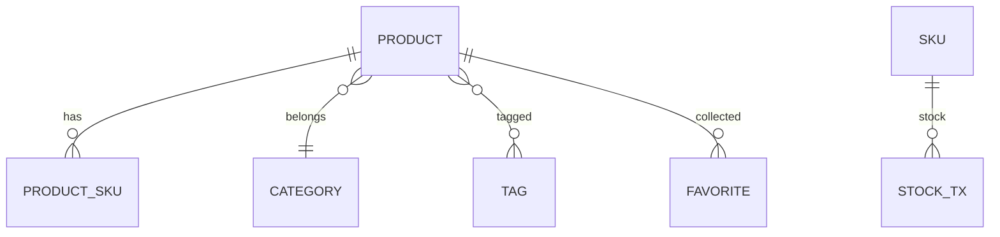

# 商品 Product

商品是商城可售单元，含 SPU、SKU、分类、标签、促销与库存。

## 什么是商品？

product-service 持有商品主数据；收藏与商品同库以便列表 join。order-service 另有精简 `ProductMapper.xml` / `ProductSkuMapper.xml` 供下单读价库存，不是第二套后台。

**关键特征**:
- C 端列表/详情 `/api/products`
- 首页聚合 `GET /api/home`
- 后台 CRUD `/api/admin/products`
- 库存子域 `/api/admin/stock/**`

## 代码位置

| 方面 | 位置 |
|------|------|
| C 端 | `ProductController.java`, `HomeController.java` |
| 后台 | `AdminProductController.java` |
| SKU XML | `mappers/product/ProductSkuMapper.xml` |
| 库存 | `mappers/stock/*` |
| 促销计算（共享） | `common/.../promotion/PromotionCalculator.java` |

## 结构

后台还可管理品牌列表、dashboard、规格组/值、标签绑定、促销结束与统计。

图片：`WebMvcConfig` 将 `/image/**` 映射到上传目录；网关转到 product-service。

## 不变量

1. 更具体的商品路径必须写在网关 user-service `/api/**` 之前。
2. AI 可查可改商品：`/internal/ai/product/{id}`（写操作需内部 Token）。
3. 促销规则配置与下单报价共用 common 计算器，避免两端公式分叉。

## 关系

