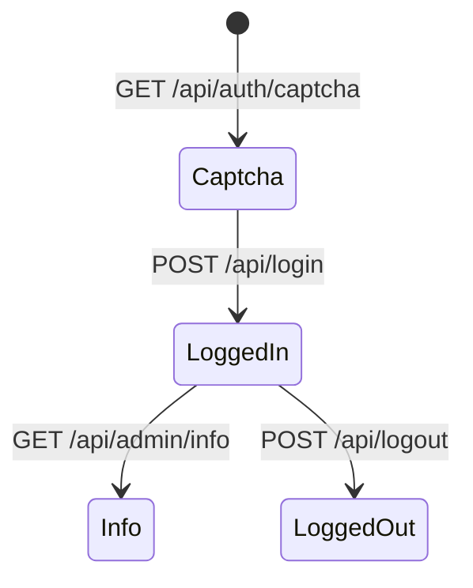

# RBAC 后台权限

RBAC 控制管理端菜单、接口按钮权限与管理员账号。

## 什么是 RBAC？

管理员登录由 auth-service 签发 JWT；菜单、角色、用户绑定在 system-service。接口级权限用 `@RequirePerm` + `PermissionInterceptor`。

**关键特征**:
- 登录与 captcha 在 auth-service，避免被 system 路径吞掉
- 网关将 `/api/admin/system/**` 与 `/api/admin/monitor/**` 明确打到 system-service
- 操作日志异步：`OperationLogAspect` + `JdbcOperationLogRecorder`

## 代码位置

| 方面 | 位置 |
|------|------|
| 登录 | `auth-service/.../AuthController.java` |
| 菜单/角色/用户 | `system-service/.../AdminSystem*Controller.java` |
| Mapper | `RbacMapper.xml`, `AdminMenuMapper.xml` 等 |
| 注解 | `common/.../annotation/RequirePerm.java` |
| 会话 | `AdminOnlineSessionStore`, `AdminTokenRevocationStore` |

## 不变量

1. 全服务 `JWT_SECRET` 必须一致。
2. 令牌可被 Redis 吊销；超时配置见各服务 Redis timeout。
3. 权限码与菜单绑定，新增后台接口应补权限而非只加路由。

## 生命周期

